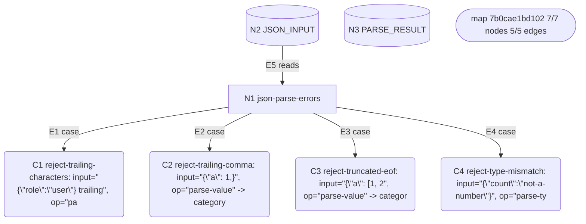
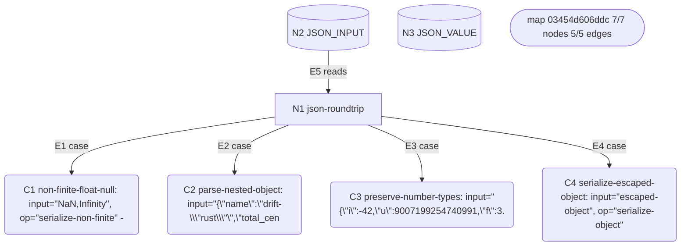

# DRIFT Real-World PR Showcase — `serde_json` (Rust / Cargo)

This fork demonstrates **[DRIFT Free (`v0.11.0`)](https://github.com/rad-ox/drift)** running in live GitHub Actions pull-request checks on **[`serde_json`](https://github.com/serde-rs/json)** (based on upstream commit `f51fa15a7015`), using the zero-dependency Rust test bridge **`drift_rust 0.11.0`** (`strict_when: true` / `DRIFT_STRICT_WHEN=1`, automatic `drift.observation/1` emission, and exact `0.3` `eq` semantics without `1e-9` float slack).

- **Reproducible benchmark harness:** [rad-ox/drift-realworld](https://github.com/rad-ox/drift-realworld) (`targets/serde-json`)
- **Important:** All demo PRs target this fork's `main` branch only — never upstream `serde-rs/json`.

## Hardened `v0.11.0` Policy & Local Verification

`.drift/config.toml` uses the hardened `v0.11.0` `--observed` policy (`pack = "core@1"`, `proof = "verified"`, `require_observations = true`).

Run the end-to-end gate and independent MIT verifier parity check locally:

```bash
DRIFT_STRICT_WHEN=1 drift run --events .drift-work/events --gate -- cargo test --test drift_json

drift gate .drift/contracts --events .drift-work/events --json > .drift-work/gate.json
python3 ~/.local/share/drift/verifier/drift_verify.py \
  .drift/contracts \
  --config .drift/config.toml \
  --events .drift-work/events \
  --compare-gate .drift-work/gate.json \
  --json
```

## Contract Maps (`drift map --as mermaid`)

### `json-parse-errors`



### `json-roundtrip`



## Demo Pull Requests (against `main`)

Every push and PR runs two parallel GitHub Actions checks so you can inspect the exact contrast directly in the PR Checks panel:

1. **`Native cargo test`** — Standard Cargo integration test execution (`cargo test --test drift_json`) without the DRIFT gate.
2. **`DRIFT v0.11.0 Gate + Independent MIT Verifier`** — Installs the SHA256-verified `v0.11.0` release, runs `DRIFT_STRICT_WHEN=1 drift run --events .drift-work/events --gate -- cargo test --test drift_json`, and confirms exact verdict parity with `drift_verify.py --compare-gate gate.json --json`.

| PR | Branch | Scenario | Native cargo test | DRIFT v0.11.0 Gate + MIT Verifier |
|:---:|---|---|:---:|:---:|
| `#1` | `demo/false-green` | Drops `tri!(de.end())` in `src/de.rs` so trailing characters (`{"role":"user"} trailing`) silently parse, and weakens `reject_trailing_characters` so `cargo test` passes | `PASS` | **`FAIL`** (`bound` / missing observation; verifier parity `true`) |
| `#2` | `demo/valid-fix` | Legitimate behavior-preserving refactor in `src/de.rs` (`Deserializer::end()`) keeping trailing-character enforcement and all observed contract proofs intact | `PASS` | `PASS` (`verified`; verifier parity `true`) |
| `#3` | `demo/free-limit` | **Honest DRIFT Free limit:** keeps the trailing-character regression unfixed and passes hardcoded expected literals directly into `ctx.check_projection(...)` — showing what Free alone does **not** block without read-only acceptance tests (`CODEOWNERS` / CI boundary) or Enterprise mutation proofs ([`GUARANTEES.md`](https://github.com/rad-ox/drift/blob/main/GUARANTEES.md)) | `PASS` | `PASS` (not blocked; honest Free boundary) |
